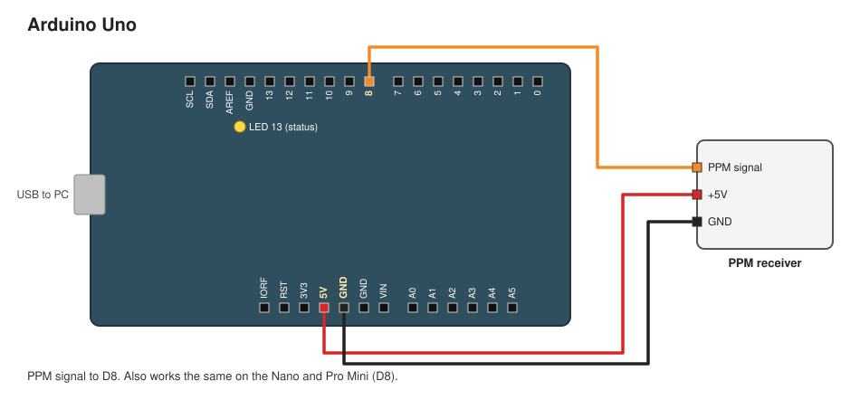

# ppm-to-ibus-serial
Arduino sketches to use your RC transmitter and receiver as a game controller on a PC, e.g. for flight simulators.

Pick the sketch that matches your receiver and Arduino:

| Sketch | Receiver output | Arduino | On the PC |
|---|---|---|---|
| [ppm-to-ibus-serial](ppm-to-ibus-serial) | PPM | Any: Uno, Nano, Pro Mini, Leonardo, Micro, Pro Micro, Mega | [vJoySerialFeeder](https://github.com/Cleric-K/vJoySerialFeeder) |
| [ppm-to-usb-joystick](ppm-to-usb-joystick) | PPM | Leonardo, Micro, Pro Micro | Nothing, it's a USB game controller |
| [ibus-to-usb-joystick](ibus-to-usb-joystick) | FlySky iBus | Leonardo, Micro, Pro Micro | Nothing, it's a USB game controller |

**Don't** use ppm-to-ibus-serial if your receiver already supports IBus (_pretty pointless_), vJoySerialFeeder can read it directly.

Each folder is an Arduino sketch, open the `.ino` file in it with the Arduino IDE. The folder's README has the wiring, settings and troubleshooting.

## What they have in common
* The PPM sketches measure the pulses with the timer's hardware input capture (0.5us resolution, unaffected by other interrupts), filter out the remaining jitter, and check the signal at power-on to adjust to your radio.
* All of them recover from glitches by themselves, and stop (serial) or center the sticks (USB) when the signal is lost.
* The LED shows the status: fast flash = checking / waiting for a signal, on = receiving, slow flash = signal lost.
* `DEBUG_OUTPUT` prints what the sketch sees, readable in the Arduino Serial Monitor.

## Wiring diagrams
In [docs/wiring](docs/wiring), for every sketch and board. They're simplified, always check the labels printed on your board.

## Testing
[test/run.sh](test/run.sh) builds every sketch, runs them in the [simavr](https://github.com/buserror/simavr) simulator (Uno and Leonardo), feeds them synthetic PPM / iBus signals and checks what they send, the boot check, the status LED and the debug output. It also checks that the code shared between sketches is identical. See the script for the packages it needs.

## History
The USB joystick sketches used to live in their own repositories, [flysky-ibus-leonardo](https://github.com/wdcossey/flysky-ibus-leonardo) and [ppm-leonardo](https://github.com/wdcossey/ppm-leonardo).
