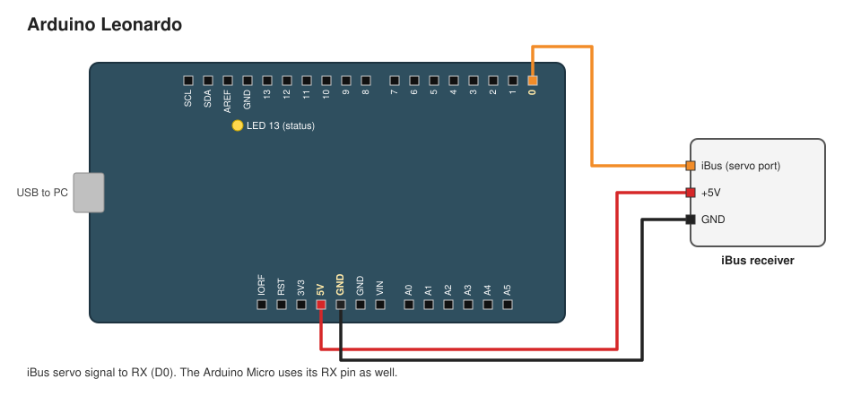
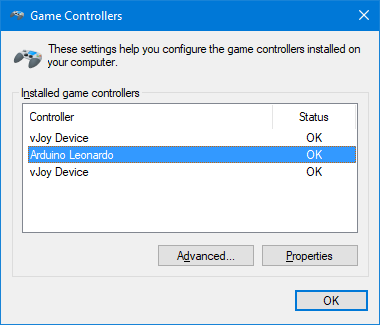
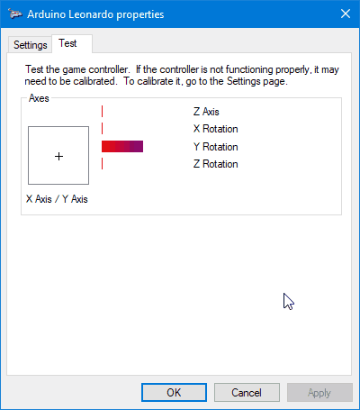

# ibus-to-usb-joystick
Decodes FlySky IBus data directly to an Arduino Leonardo USB Game Controller.

The Arduino sketch can be found [here](ibus-to-usb-joystick.ino), simply build and upload it to your Leonardo.

Hardware:
* iBus compatible RC receiver (e.g. FlySky FS-iA6B, FS-iA10B, FS-X6B).
* Arduino Leonardo, Micro or Pro Micro (ATmega32u4 microcontroller). A Pro Micro clone makes a tiny, cheap controller.

Software:
* There's **no** need for any special software or virtual joysticks as it's all controlled by the microcontroller.
* Build it with the [Joystick](https://github.com/MHeironimus/ArduinoJoystickLibrary) library by [Matthew Heironimus](https://github.com/MHeironimus) (install it from the Arduino Library Manager, search for "Joystick").

If your receiver only has PPM, use [ppm-to-usb-joystick](../ppm-to-usb-joystick) instead.

## Wiring

| Board | iBus pin | Wiring |
|---|---|---|
| Leonardo, Micro | **RX (D0)** | [diagram](../docs/wiring/ibus-leonardo.svg) |
| Pro Micro | **RX1** | [diagram](../docs/wiring/ibus-promicro.svg) |

Use the receiver's iBus **servo** port (some receivers also have an iBus **sensor** port, which is something else). Connect the receiver's GND to the Arduino's GND. The diagrams are simplified, always check the labels printed on your board.

> **Upgrading from the 2018 version (flysky-ibus-leonardo)?** The iBus wire has moved from pin 10 to the **RX (D0)** pin. The hardware serial port there is much more reliable than the software serial port the old version used.

## Channel Mapping

Source | Target
------------ | -------------
Channel 1 | X Axis
Channel 2 | Y Axis
Channel 3 | X Rotation
Channel 4 | Y Rotation
Channel 5 | Z Axis
Channel 6 | Z Rotation
Channels 7-10 | Buttons 1-4 (pressed when the channel is above 1750, e.g. a switch in its "up" position)

The mapping can be changed at the top of the sketch (`AXIS_*_CHANNEL`, `BUTTON_*`). Uses X-Axis, Y-Axis, Z-Axis, Rx-Axis, Ry-Axis, Rz-Axis (simply [re]calibrate the controller in your sim of choice).

## Behaviour
* Frames with a bad checksum are ignored, and the decoder re-synchronises by itself.
* If the receiver stops sending (unplugged, powered off) for 100ms, all axes are centered and buttons released.

## Status LED

| LED | Meaning |
|---|---|
| Fast flash | Waiting for iBus data |
| On | Receiving iBus |
| Slow flash | iBus signal lost (axes centered) |

The LED is the one on pin 13 on the Leonardo and Micro. The Pro Micro doesn't have one, set `STATUS_LED_PIN` to `17` and `STATUS_LED_ON` to `LOW` to use its RX LED instead.

## Troubleshooting
Set `DEBUG_OUTPUT` to `1`, upload, and open the Arduino Serial Monitor. It prints the values sent to the PC (number of channels, X Y Z Rx Ry Rz, then the buttons), or `No signal`.

## Testing
[test/run.sh](../test/run.sh) runs the sketch in the [simavr](https://github.com/buserror/simavr) ATmega32u4 simulator, feeds it iBus data (noise, corrupted frames, signal loss, ...) and checks the values it sends and the status LED.

Screen recording by [ScreenToGif](https://github.com/NickeManarin/ScreenToGif)
