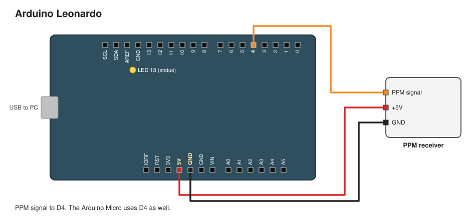

# ppm-to-usb-joystick
Decodes PPM data directly to an Arduino Leonardo USB Game Controller.

The Arduino sketch can be found [here](ppm-to-usb-joystick.ino), build and upload it to your Leonardo.

This sketch requires nothing other than:
1. PPM compatible RC receiver (or any other PPM source, e.g. a transmitter's trainer port).
2. Arduino Leonardo, Micro or Pro Micro (ATmega32u4 microcontroller). A Pro Micro clone makes a tiny, cheap controller.

There's **no** need for any software or virtual joysticks as it's all controlled by the microcontroller.

Build it with the [Joystick](https://github.com/MHeironimus/ArduinoJoystickLibrary) library by [Matthew Heironimus](https://github.com/MHeironimus) (install it from the Arduino Library Manager, search for "Joystick").

If your receiver has iBus, use [ibus-to-usb-joystick](../ibus-to-usb-joystick) instead. For other Arduinos (Uno, Nano, ...) see [ppm-to-ibus-serial](../ppm-to-ibus-serial), which works with [vJoySerialFeeder](https://github.com/Cleric-K/vJoySerialFeeder).

## Wiring

| Board | PPM pin | Wiring |
|---|---|---|
| Leonardo, Micro | **D4** | [diagram](../docs/wiring/ppm-leonardo.svg) |
| Pro Micro | **4** | [diagram](../docs/wiring/ppm-promicro.svg) |

D4 is the Timer1 input capture pin, it can't be changed. Connect the receiver's GND to the Arduino's GND. The PPM signal must reach about 3V for the Arduino to read it reliably. Normal and inverted PPM both work.

The diagrams are simplified, always check the labels printed on your board.

## Channel Mapping

Source | Target
------------ | -------------
Channel 1 | X Axis
Channel 2 | Y Axis
Channel 3 | X Rotation
Channel 4 | Y Rotation
Channel 5 | Z Axis
Channel 6 | Z Rotation
Channels 7-10 | Buttons 1-4 (pressed when the channel is above 1750us, e.g. a switch in its "up" position)

The mapping can be changed at the top of the sketch (`AXIS_*_CHANNEL`, `BUTTON_*`). Calibrate the controller in Windows (or your sim of choice) after uploading.

## Features
* Boot check: for the first 2 seconds after the PPM signal appears, the sketch works out the frame layout (number of channels, gap between frames) and adjusts its timing limits to suit the radio. Power cycle to check again, e.g. after changing radios.
* Automatically detects the number of PPM channels (4 to 14).
* Measures the pulses with the timer's hardware input capture (0.5us resolution), unaffected by USB or other interrupts.
* Jitter filter: `PPM_JITTER_THRESHOLD` (default 4us). A channel only moves once its value changes by more than this, so sticks held still stay still (big, quick moves are followed straight away). Raise it (e.g. 8) for a noisy receiver, `0` disables it.
* Re-synchronises on every PPM frame and drops damaged frames, so glitches don't scramble the channels.
* If the PPM signal is lost for 100ms, all axes are centered and buttons released.

## Status LED

| LED | Meaning |
|---|---|
| Fast flash | Boot check running, or waiting for a PPM signal |
| On | Receiving PPM |
| Slow flash | PPM signal lost (axes centered) |

The LED is the one on pin 13 on the Leonardo and Micro. The Pro Micro doesn't have one, set `STATUS_LED_PIN` to `17` and `STATUS_LED_ON` to `LOW` to use its RX LED instead.

## Troubleshooting
Set `DEBUG_OUTPUT` to `1`, upload, and open the Arduino Serial Monitor. It prints what the boot check found, then the number of PPM channels and the values sent to the PC (X Y Z Rx Ry Rz, then the buttons), or `No signal`. If the LED keeps flashing fast, check the pin, the ground connection, that the receiver is bound and actually in PPM mode, and the signal voltage.

`DEBUG_OUTPUT` `2` also prints the raw timing of the PPM signal, see [ppm-to-ibus-serial](../ppm-to-ibus-serial#raw-timing-debug_output-2) for how to read it.

## Testing
[test/run.sh](../test/run.sh) runs the sketch in the [simavr](https://github.com/buserror/simavr) ATmega32u4 simulator, feeds it synthetic PPM signals (jitter, glitches, signal loss, channel count changes, inverted PPM, short frame gaps, ...) and checks the values it sends and the status LED.
